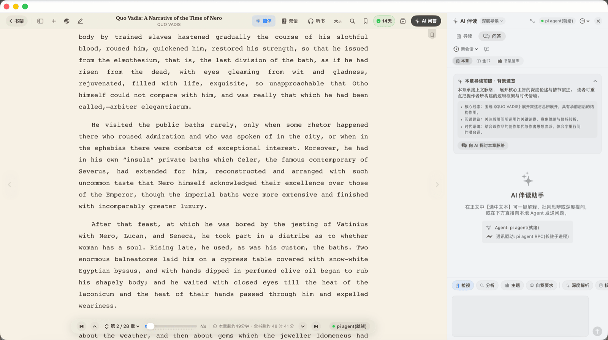

# DReader — Native macOS AI EPUB Reader (Swift 6 · SwiftUI)

[](https://www.apple.com/macos/)
[](https://swift.org)
[](https://developer.apple.com/xcode/swiftui/)
[](Package.swift)
[](https://github.com/DaviRain-Su/dreader/actions/workflows/ci.yml)
[](https://github.com/DaviRain-Su/dreader/releases)
[](https://github.com/DaviRain-Su/dreader/stargazers)

**English** · [简体中文](README.zh-CN.md)

---

**DReader** is a native **macOS e-book reader** for people who read seriously. It opens **EPUB, MOBI/AZW3, Markdown and PDF**, renders **Chinese vertical typography** the way printed books do, and pairs every page with a **local-first AI reading companion** — so your library, your highlights and your questions never leave your Mac.

No Electron. No bundled Chromium. ~39k lines of Swift 6 and SwiftUI, **zero third-party Swift dependencies**.


---

## Table of contents

- [Why DReader](#why-dreader)
- [Features](#features)
- [Supported formats](#supported-formats)
- [Install](#install)
- [Keyboard shortcuts](#keyboard-shortcuts)
- [MCP server — let any AI read your library](#mcp-server--let-any-ai-read-your-library)
- [FAQ](#faq)
- [Roadmap](#roadmap)
- [Project layout](#project-layout)
- [License](#license)

---

## Why DReader

Most "modern" e-readers are web apps in a trench coat: Electron shells that idle at 800 MB, stutter on scroll, and ship your reading data to someone else's server.

DReader takes the opposite bet.

| | DReader | Typical Electron reader |
| :--- | :--- | :--- |
| **Runtime** | Native Swift 6 + SwiftUI + WebKit | Chromium + Node.js |
| **Idle memory** | Tens of MB | Hundreds of MB |
| **Scrolling** | ProMotion 120 Hz, native | Compositor-bound |
| **AI backend** | Your own local agent (`pi`), your keys | Vendor cloud API |
| **Your data** | Local SQLite, on your disk | Vendor account |
| **Chinese typography** | Vertical right-to-left, GB18030/Big5/UTF-8 | Usually Latin-first |

---

## Features

### A bookshelf, not a file list

The app opens into a **photorealistic walnut bookshelf**: real wood grain, ambient top-light falloff, bevelled shelf edges, and 3D hardcover books with curved spine shading, visible page-block layering, gold-foil ornament and a silk bookmark ribbon.

- Multiple shelves, instant title search, and one-click import
- Gallery ("long corridor") mode for large libraries
- Per-book progress badges and a daily reading streak counter

### Native typography built for CJK

- **Chinese vertical layout** (`writing-mode: vertical-rl`) — right-to-left classical columns, auto-detected for Chinese classics
- **Traditional ↔ Simplified** conversion in one keystroke, without touching the source file
- **6 reading themes** — Sepia, Daylight, Linen Grey, Bamboo Green, Warm Night, OLED Black
- Fine-grained controls: font size, line height, measure width (720 px golden ratio by default), justified text, serif/sans toggle
- **Two-page spread** with a centre-gutter shadow, and a **Zen mode** that hides every chrome element


### An AI companion, not a chatbot bolted on

Reading and asking are the same gesture. Select any passage and a native floating toolbar appears:

| Action | What it does |
| :--- | :--- |
| 💬 **Ask AI** | Injects the selection as context into the companion panel |
| 💡 **Explain** | Unpacks metaphor, allusion and historical background |
| 📝 **Summarise** | Extracts the core claim plus three key points |
| 🌐 **Translate** | Literary-grade side-by-side translation |
| 🖍️ **Highlight** | Five colours — yellow, green, blue, pink, orange — persisted to your notebook |
| 📋 **Copy** | Plain-text copy of the passage |

The panel itself is a **chapter guide**, not a blank text box: it generates a pre-reading briefing (overview, three background points, Socratic questions) and lets you push the chapter's argument further with follow-up questions.



**Four companion personas** — Deep Guide (literary scholar), Critical Thinker (adversarial reviewer), Idea Distiller, and Literary Translator.

**How the AI runs.** All inference goes through a single local agent runtime, [`pi`](https://pi.dev), which DReader drives over a persistent RPC protocol in **four independent lanes** — 1 chat, 1 guide, 2 translation — so stopping a translation never kills your conversation. Model selection and API keys live in `pi` (`~/.pi/agent/models.json`), which means DReader works with whichever providers `pi` is configured for (Anthropic, OpenAI, GLM, Kimi, Grok, local models…) without storing a single key itself.

### Bilingual reading

Turn any chapter — or the whole book — into a **side-by-side bilingual spread**. Translation runs as a chapter-level batch queue with an echo guard, a chapter fingerprint to invalidate stale results, and serialised per-chapter writes, so a half-translated chapter can never corrupt your file.

### Highlights, notes and review

- Margin notes rendered beside the text, anchored by a context-snapshot disambiguation chain so highlights survive re-parsing
- **Cross-book search** across your entire highlight corpus (Traditional → Simplified normalisation, fuzzy matching)
- **Mastery review** — daily spaced-repetition cards drawn from your own highlights
- Export to **Markdown / Obsidian**, or as a styled quote card image

### Reading, listening, syncing

- **Local neural text-to-speech** (Piper) reads whole chapters aloud — fully offline
- **WeRead (微信读书) sync** — pull your highlights and thoughts into the local library
- **Curated rankings** — Douban snapshots, WeChat real-time lists, and international prize catalogues (Nobel, Booker) with cover art
- **iCloud backup** for library and notes
- **X-Ray** — character and concept index for the book you're reading

---

## Supported formats

| Format | Extension | Notes |
| :--- | :--- | :--- |
| EPUB | `.epub` | EPUB 2 & 3, namespaced XML, repaired HTML entities, GB18030 / Big5 / UTF-8 |
| Kindle | `.mobi` `.azw3` `.azw` `.prc` | Via vendored libmobi 0.12 |
| Markdown | `.md` `.markdown` | Via vendored cmark 0.31.1 |
| PDF | `.pdf` | Layout import with page rendering |

> **Why `ditto` instead of `unzip`?** macOS's Info-ZIP `unzip` aborts on Chinese / Unicode / GBK filenames inside EPUB archives. DReader shells out to Apple's native `/usr/bin/ditto -xk`, which handles them correctly. That single decision is why the importer clears real-world multi-volume Chinese EPUBs instead of failing halfway.

---

## Install

### Download the app (Apple Silicon)

Grab the latest `DReader-macOS-arm64-*.zip` from [**Releases**](https://github.com/DaviRain-Su/dreader/releases), unzip, and open `DReader.app`.

The bundle is ad-hoc signed, so on first launch use **right-click → Open**, or:

```bash
xattr -dr com.apple.quarantine /Applications/DReader.app
```

### Build from source

Requires **macOS 14+** and **Swift 6 / Xcode 16+**.

```bash
git clone https://github.com/DaviRain-Su/dreader.git
cd dreader

# Option A — build a signed .app bundle
./build-app.sh && open DReader.app

# Option B — run straight from SwiftPM
swift run DReader

# Option C — develop in Xcode
open Package.swift
```

### Enable the AI companion

```bash
curl -fsSL https://pi.dev/install.sh | sh
pi          # run once to log in / configure providers
```

DReader detects `pi` on `PATH` automatically. Without it, everything except AI features still works.

---

## Keyboard shortcuts

| Shortcut | Action |
| :--- | :--- |
| `⌘ O` | Open and import a local book |
| `⌘ B` | Back to the bookshelf |
| `⌘ L` | Online library explorer |
| `⌘ G` | Curated rankings & book lists |
| `⌘ ⇧ N` | Global highlights & thoughts centre |
| `⌘ ⇧ W` | WeRead highlight sync |
| `⌘ ⇧ S` | Read chapter aloud (text-to-speech) |
| `⌘ ⇧ R` | Daily highlight mastery review |
| `⌘ [` / `⌘ ]` | Previous / next chapter |
| `Page Up` / `Page Down` | Page up / down |
| `⌘ +` / `⌘ -` | Increase / decrease font size |
| `⌘ ⇧ D` | Toggle single-page / two-page spread |
| `⌘ Return` | Enter / exit Zen mode |
| `⌘ ⇧ M` | Show / hide margin notes |
| `⌘ ⇧ L` | Toggle light / dark theme |
| `⌘ T` | Toggle bilingual paragraph alignment |
| `⌘ ⇧ T` | AI-translate the current chapter |
| `⌥ ⌘ ⇧ T` | AI-translate the whole book |
| `⌘ ⇧ C` | Convert Traditional → Simplified |
| `⌘ ⇧ K` | Toggle the AI companion panel |

---

## MCP server — let any AI read your library

DReader ships a local **MCP (Model Context Protocol)** server, `dreader-mcp`, that exposes your shelf, highlights and reading stats to Claude Desktop, Claude Code, or any MCP-capable client. Ask *"what did I highlight about attention last month?"* and the model can actually answer.

It reads the same SQLite database as the app — no export, no duplication, no cloud.

| Tool | Capability |
| :--- | :--- |
| `list_books` | List every book on the shelf with metadata |
| `search_highlights` | Full-text search across all highlights (Traditional → Simplified normalised, fuzzy) |
| `get_book_notes` | Every highlight and note for one book |
| `get_chapter_text` | Full source text of a given chapter |
| `get_reading_stats` | Reading days, word counts, highlight counts |

### Setup

```bash
# 1. Clone and build the MCP binary
git clone https://github.com/DaviRain-Su/dreader.git
cd dreader
swift build -c release --product dreader-mcp

# 2. (optional) smoke-test the binary
echo '{"jsonrpc":"2.0","id":1,"method":"initialize","params":{"protocolVersion":"2024-11-05","capabilities":{},"clientInfo":{"name":"test","version":"1.0"}}}' \
  | .build/release/dreader-mcp

# 3. Register with Claude Code
claude mcp add dreader -- "$(pwd)/.build/release/dreader-mcp"
```

**Claude Desktop** — edit `~/Library/Application Support/Claude/claude_desktop_config.json`:

```json
{
  "mcpServers": {
    "dreader": {
      "command": "/absolute/path/to/dreader/.build/release/dreader-mcp"
    }
  }
}
```

**Claude Code** — the repo ships a `.mcp.json` using `${CLAUDE_PROJECT_DIR}`; build the product and restart Claude Code.

> The server reads `~/Library/Application Support/DReader` directly, so it always sees the same library as the app.

---

## FAQ

**Is DReader a native macOS app or an Electron wrapper?**
Native. Swift 6, SwiftUI and WebKit, with no third-party Swift package dependencies. The only vendored C libraries are cmark (Markdown) and libmobi (Kindle formats).

**Can it read Chinese EPUB files with vertical text?**
Yes. DReader detects CJK content and offers `writing-mode: vertical-rl` right-to-left layout, plus one-key Traditional ↔ Simplified conversion and GB18030 / Big5 / UTF-8 encoding detection.

**Does it need an internet connection?**
No. Reading, highlighting, notes, text-to-speech (Piper) and library management are fully offline. Only AI features need `pi` and whatever provider you point it at.

**Which AI models can it use?**
Whichever `pi` is configured for — Anthropic Claude, OpenAI, GLM, Kimi, Grok, or local models. DReader never stores API keys itself; it talks to `pi` over a local RPC socket.

**Can it open Kindle MOBI and AZW3 files?**
Yes, via vendored libmobi 0.12. `.mobi`, `.azw3`, `.azw` and `.prc` are all accepted.

**Where is my data stored?**
`~/Library/Application Support/DReader` — a local SQLite database plus your book files. Nothing is uploaded. Optional iCloud backup is opt-in.

**Can Claude or ChatGPT read my highlights?**
Through the bundled `dreader-mcp` server, yes — locally, over stdio, with no third-party service in the loop.

**Does it run on Intel Macs?**
The prebuilt release is Apple Silicon (arm64). Intel users can build from source.

---

## Roadmap

- [x] Native EPUB / MOBI / Markdown / PDF import
- [x] Local MCP server (`dreader-mcp`, 5 tools)
- [x] AI companion over `pi` agent RPC (chat / guide / translation lanes)
- [x] Chapter-level bilingual side-by-side translation
- [x] Local neural text-to-speech
- [ ] Multimodal PDF layout reconstruction
- [ ] Direct Obsidian vault sync (beyond Markdown export)
- [ ] Custom cloud agent endpoints

---

## Project layout

```
Sources/
  DReader/          macOS app — SwiftUI views, view models, services
  dreader-mcp/      Local MCP server (stdio JSON-RPC)
Vendor/
  Cmark/            cmark 0.31.1      (BSD-2-Clause)
  Cmobi/            libmobi 0.12      (LGPL-3.0-or-later)
Tests/
  DReaderTests/     Unit + regression tests, real-world EPUB/MOBI fixtures
```

```bash
swift build                 # debug build
swift test                  # run the test suite
swift build -c release      # release build
```

---

## License

This repository does not yet declare a top-level license — all rights reserved by default. If you intend to use, fork or redistribute DReader, please open an issue to discuss.

Vendored components carry their own terms:

- **cmark 0.31.1** — BSD-2-Clause (`Vendor/Cmark/COPYING-BSD`)
- **libmobi 0.12** — LGPL-3.0-or-later (`Vendor/Cmobi/COPYING-LGPL`), statically linked; source is available in `Vendor/Cmobi`, satisfying the relink obligation.

---

<p align="center">
  <sub>Built with Swift 6, SwiftUI and WebKit · EPUB · MOBI · AZW3 · Markdown · PDF · ACP · MCP · local-first</sub>
</p>
