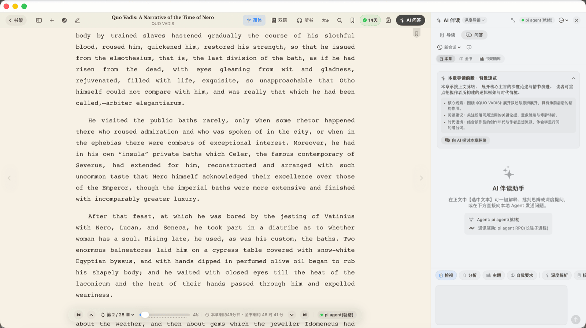

# DReader — macOS 原生 AI 电子书阅读器（Swift 6 · SwiftUI）

[](https://www.apple.com/macos/)
[](https://swift.org)
[](https://developer.apple.com/xcode/swiftui/)
[](Package.swift)
[](https://github.com/DaviRain-Su/dreader/actions/workflows/ci.yml)
[](https://github.com/DaviRain-Su/dreader/releases)
[](https://github.com/DaviRain-Su/dreader/stargazers)
[](LICENSE)

[English](README.md) · **简体中文**

---

**DReader** 是一款为「认真读书的人」打造的 **macOS 原生电子书阅读器**。支持 **EPUB、MOBI/AZW3、Markdown 与 PDF**，能像纸质书一样呈现**中文竖排**版式，并为每一页配一位**本地优先的 AI 伴读**——书库、划线、提问都不离开你的 Mac。

没有 Electron，没有内嵌 Chromium。约 3.9 万行 Swift 6 / SwiftUI 代码，**零第三方 Swift 依赖**。


---

## 目录

- [为什么选 DReader](#为什么选-dreader)
- [核心特性](#核心特性)
- [支持格式](#支持格式)
- [安装](#安装)
- [快捷键](#快捷键)
- [MCP Server：让任意 AI 读懂你的书房](#mcp-server让任意-ai-读懂你的书房)
- [常见问题](#常见问题)
- [迭代路线](#迭代路线)
- [项目结构](#项目结构)
- [许可](#许可)

---

## 为什么选 DReader

大多数「现代」阅读器本质是套了壳的网页：Electron 空转就占 800 MB，滚动掉帧，还把阅读数据发到别人的服务器。

DReader 走的是相反的一条路。

| | DReader | 典型 Electron 阅读器 |
| :--- | :--- | :--- |
| **运行时** | 原生 Swift 6 + SwiftUI + WebKit | Chromium + Node.js |
| **空闲内存** | 数十 MB | 数百 MB |
| **滚动** | ProMotion 120 Hz 原生 | 受合成器限制 |
| **AI 后端** | 你自己的本地 Agent（`pi`），自己的密钥 | 厂商云 API |
| **你的数据** | 本地 SQLite，存在你自己盘上 | 厂商账号 |
| **中文排版** | 竖排右起左行，GB18030 / Big5 / UTF-8 | 多为拉丁文优先 |

---

## 核心特性

### 拟真 3D 胡桃木书架大厅

启动即进入**实木书架大厅**：真实木纹、层架背板漫反射顶光渐变、立体边缘倒角阴影，以及带书脊弧面凹折光影、侧边内页纸质层理、烫金古典花纹与丝绸书签缎带的 3D 精装图书。

- 多层书架陈列、书名即时检索、一键导入新书
- 「长廊预览」画廊模式，适合大书库
- 每本书的阅读进度徽章与连续阅读天数统计

### 为中文而生的原生排版

- **中文竖排**（`writing-mode: vertical-rl`）——右起左行古典版式，中文古籍自动识别
- **繁简一键转换**，不改动源文件
- **6 种阅读主题**：典雅羊皮纸、纯净白昼、极简亚麻灰、竹韵护眼、暖夜深褐、黑曜极夜
- 细致排版调节器：字号、行距、阅读栏宽（默认 720 px 黄金视距）、两端对齐、衬线 / 无衬线切换
- **双页对开**（带中缝内阴影）与**禅意沉浸模式**（隐藏全部界面元素）


### AI 伴读，而不是外挂一个聊天框

阅读与提问是同一个动作。选中任意段落，原生浮动工具栏自动浮现：

| 操作 | 作用 |
| :--- | :--- |
| 💬 **问 AI** | 把选中文本作为语境注入伴读面板 |
| 💡 **解释** | 解析隐喻、典故与时代背景 |
| 📝 **总结** | 萃取核心观点与 3 个关键要点 |
| 🌐 **翻译** | 文学级对照翻译 |
| 🖍️ **划线** | 黄 / 绿 / 蓝 / 粉 / 橙 5 色荧光，持久化到笔记库 |
| 📋 **复制** | 纯文本复制选中段落 |

面板本身是**章节导读**而非空白输入框：自动生成读前简报（内容概览、三条背景要点、苏格拉底式追问），并可继续就本章论点追问。



**4 种伴读角色**——深度导读学者、批判性思考者、灵感提炼师、文学精译官。

**AI 是怎么跑起来的。** 全部推理经由单一本地 Agent 运行时 [`pi`](https://pi.dev)，DReader 通过常驻 RPC 协议驱动 **4 条独立通道**——1 条聊天、1 条导读、2 条翻译——因此「停止翻译」永远不会误杀正在进行的对话。模型与密钥由 `pi` 统一管理（`~/.pi/agent/models.json`），DReader 自身不存任何 API Key，支持 `pi` 已配置的任意 provider（Anthropic、OpenAI、GLM、Kimi、Grok、本地模型等）。

### 双语对照阅读

任意章节——或整本书——可切换为**左右分栏双语对照**。翻译走章级批翻队列，带回声闸、章节指纹判废与同章串行落盘，半翻完的章节不会污染文件。

### 划线、笔记与复习

- 页边批注贴着正文渲染，锚定采用选区前后文快照的消歧链，重新解析后划线依然能恢复
- **跨书检索**整个划线语料库（繁→简归一化，支持模糊匹配）
- **Mastery 复习**——从你自己的划线里生成每日间隔重复卡片
- 导出 **Markdown / Obsidian**，或生成带排版的摘录卡片图片

### 阅读、听书与同步

- **本地神经语音合成**（Piper）整章朗读，完全离线
- **微信读书同步**——把划线与想法拉进本地书库
- **精选榜单**——豆瓣快照、微信实时榜、国际奖项书单（诺贝尔、布克），含封面
- **iCloud 备份**书库与笔记
- **X-Ray**——当前书籍的人物与概念索引

---

## 支持格式

| 格式 | 扩展名 | 说明 |
| :--- | :--- | :--- |
| EPUB | `.epub` | EPUB 2 & 3，命名空间 XML，HTML 实体自动修复，GB18030 / Big5 / UTF-8 自适应 |
| Kindle | `.mobi` `.azw3` `.azw` `.prc` | 基于内置 libmobi 0.12 |
| Markdown | `.md` `.markdown` | 基于内置 cmark 0.31.1 |
| PDF | `.pdf` | 版面导入与页面渲染 |

> **为什么用 `ditto` 而不是 `unzip`？** macOS 自带的 Info-ZIP `unzip` 遇到 EPUB 内的中文 / Unicode / GBK 文件名会直接中止。DReader 改用 Apple 原生 `/usr/bin/ditto -xk` 解压，这一处改动就是它能吃下真实世界多卷本中文 EPUB、而不是半路失败的原因。

---

## 安装

### 直接下载（Apple Silicon）

从 [**Releases**](https://github.com/DaviRain-Su/dreader/releases) 下载最新的 `DReader-macOS-arm64-*.zip`，解压后打开 `DReader.app`。

App Bundle 为 ad-hoc 签名，首次启动请**右键 → 打开**，或执行：

```bash
xattr -dr com.apple.quarantine /Applications/DReader.app
```

### 从源码构建

需要 **macOS 14+** 与 **Swift 6 / Xcode 16+**。

```bash
git clone https://github.com/DaviRain-Su/dreader.git
cd dreader

# 方式 A —— 构建签名 .app 包
./build-app.sh && open DReader.app

# 方式 B —— 直接用 SwiftPM 运行
swift run DReader

# 方式 C —— 在 Xcode 中开发
open Package.swift
```

### 启用 AI 伴读

```bash
curl -fsSL https://pi.dev/install.sh | sh
pi          # 运行一次完成登录 / provider 配置
```

DReader 会自动在 `PATH` 上发现 `pi`。未安装时，除 AI 功能外一切照常可用。

---

## 快捷键

| 快捷键 | 功能 |
| :--- | :--- |
| `⌘ O` | 打开并导入本地书籍 |
| `⌘ B` | 返回书架大厅 |
| `⌘ L` | 在线数字书库 |
| `⌘ G` | 精选书单与榜单 |
| `⌘ ⇧ N` | 全书库划线与思考回顾中心 |
| `⌘ ⇧ W` | 微信读书划线同步 |
| `⌘ ⇧ S` | 整章朗读（听书） |
| `⌘ ⇧ R` | 今日划线 Mastery 复习 |
| `⌘ [` / `⌘ ]` | 上一章 / 下一章 |
| `Page Up` / `Page Down` | 向上 / 向下翻页 |
| `⌘ +` / `⌘ -` | 增大 / 减小字号 |
| `⌘ ⇧ D` | 切换单页 / 双页对开 |
| `⌘ Return` | 进入 / 退出禅意模式 |
| `⌘ ⇧ M` | 显示 / 隐藏页边批注 |
| `⌘ ⇧ L` | 切换白天 / 夜间主题 |
| `⌘ T` | 开启 / 关闭双语段落对照 |
| `⌘ ⇧ T` | AI 智能翻译当前章 |
| `⌥ ⌘ ⇧ T` | AI 翻译全书 |
| `⌘ ⇧ C` | 繁体 → 简体转换 |
| `⌘ ⇧ K` | 展开 / 折叠 AI 伴读面板 |

---

## MCP Server：让任意 AI 读懂你的书房

DReader 内置本地 **MCP (Model Context Protocol)** Server `dreader-mcp`，把书架、划线与阅读统计开放给 Claude Desktop、Claude Code 或任意支持 MCP 的客户端。你问「上个月我在哪本书里划过关于专注力的句子？」——模型真的能答。

它和 App 读同一份 SQLite 数据库：无需导出、无需复制、不经过云端。

| 工具 | 能力 |
| :--- | :--- |
| `list_books` | 列出书架全部藏书与元数据 |
| `search_highlights` | 跨书全文检索划线（繁→简归一化，支持模糊匹配） |
| `get_book_notes` | 读取某本书的全部划线与思考笔记 |
| `get_chapter_text` | 直读某本书某一章的完整原文 |
| `get_reading_stats` | 阅读统计（天数、字数、划线数等） |

### 安装

```bash
# 1. 克隆并构建 MCP 二进制
git clone https://github.com/DaviRain-Su/dreader.git
cd dreader
swift build -c release --product dreader-mcp

# 2.（可选）冒烟测试
echo '{"jsonrpc":"2.0","id":1,"method":"initialize","params":{"protocolVersion":"2024-11-05","capabilities":{},"clientInfo":{"name":"test","version":"1.0"}}}' \
  | .build/release/dreader-mcp

# 3. 注册到 Claude Code
claude mcp add dreader -- "$(pwd)/.build/release/dreader-mcp"
```

**Claude Desktop** —— 编辑 `~/Library/Application Support/Claude/claude_desktop_config.json`：

```json
{
  "mcpServers": {
    "dreader": {
      "command": "/absolute/path/to/dreader/.build/release/dreader-mcp"
    }
  }
}
```

**Claude Code** —— 仓库已带 `.mcp.json`（使用 `${CLAUDE_PROJECT_DIR}`），构建后重启 Claude Code 即自动发现。

> Server 直接读取 `~/Library/Application Support/DReader`，与 App 共享同一份数据，无需额外配置路径。

---

## 常见问题

**DReader 是原生 macOS 应用还是 Electron 套壳？**
原生。Swift 6 + SwiftUI + WebKit，零第三方 Swift 包依赖。仅内置两个 C 库：cmark（Markdown）与 libmobi（Kindle 格式）。

**能读中文竖排 EPUB 吗？**
能。检测到 CJK 内容后可切换 `writing-mode: vertical-rl` 右起左行版式，并支持繁简一键转换与 GB18030 / Big5 / UTF-8 编码识别。

**需要联网吗？**
不需要。阅读、划线、笔记、听书（Piper）与书库管理全部离线。只有 AI 功能需要 `pi` 以及你指定的 provider。

**能用哪些 AI 模型？**
`pi` 配置了哪些就能用哪些——Anthropic Claude、OpenAI、GLM、Kimi、Grok 或本地模型。DReader 自身不存 API Key，只通过本地 RPC 与 `pi` 通信。

**能打开 Kindle 的 MOBI / AZW3 吗？**
能，基于内置 libmobi 0.12，接受 `.mobi`、`.azw3`、`.azw`、`.prc`。

**我的数据存在哪？**
`~/Library/Application Support/DReader`——本地 SQLite 数据库加书籍文件。不上传任何内容，iCloud 备份为可选项。

**能让 Claude 或 ChatGPT 读我的划线吗？**
可以，通过内置 `dreader-mcp`，本地 stdio 通信，不经过任何第三方服务。

**Intel Mac 能用吗？**
预编译版本为 Apple Silicon（arm64）。Intel 用户可从源码自行构建。

---

## 迭代路线

- [x] 原生 EPUB / MOBI / Markdown / PDF 导入
- [x] 本地 MCP Server（`dreader-mcp`，5 个工具）
- [x] 基于 `pi` agent RPC 的 AI 伴读（聊天 / 导读 / 翻译通道）
- [x] 章级双语对照翻译
- [x] 本地神经语音合成
- [ ] 多模态 PDF 版面还原
- [ ] Obsidian vault 直接同步（超出 Markdown 导出）
- [ ] 自定义云端 Agent 接入

---

## 项目结构

```
Sources/
  DReader/          macOS 应用 —— SwiftUI 视图、视图模型、服务层
  dreader-mcp/      本地 MCP Server（stdio JSON-RPC）
Vendor/
  Cmark/            cmark 0.31.1      (BSD-2-Clause)
  Cmobi/            libmobi 0.12      (LGPL-3.0-or-later)
Tests/
  DReaderTests/     单元与回归测试，真实 EPUB / MOBI 样本
```

```bash
swift build                 # Debug 构建
swift test                  # 运行测试
swift build -c release      # Release 构建
```

---

## 许可

**MIT** —— 详见 [LICENSE](LICENSE)。可自由使用、Fork、分发。

内置组件遵循各自协议，MIT 授权不覆盖它们：

- **cmark 0.31.1** — BSD-2-Clause（`Vendor/Cmark/COPYING-BSD`）
- **libmobi 0.12** — LGPL-3.0-or-later（`Vendor/Cmobi/COPYING-LGPL`），静态链接；完整源码随仓库提供于 `Vendor/Cmobi`，满足重链接义务。

---

<p align="center">
  <sub>Swift 6 · SwiftUI · WebKit · EPUB · MOBI · AZW3 · Markdown · PDF · ACP · MCP · 本地优先</sub>
</p>
